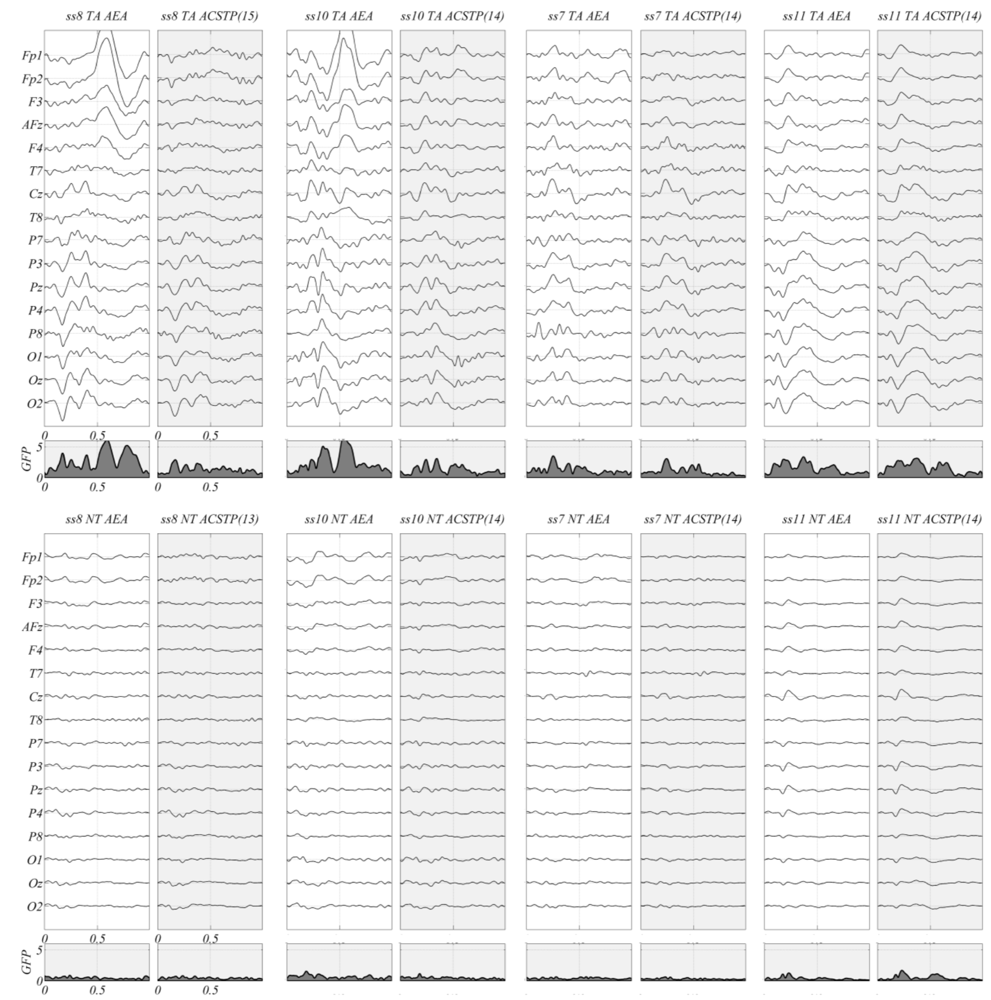
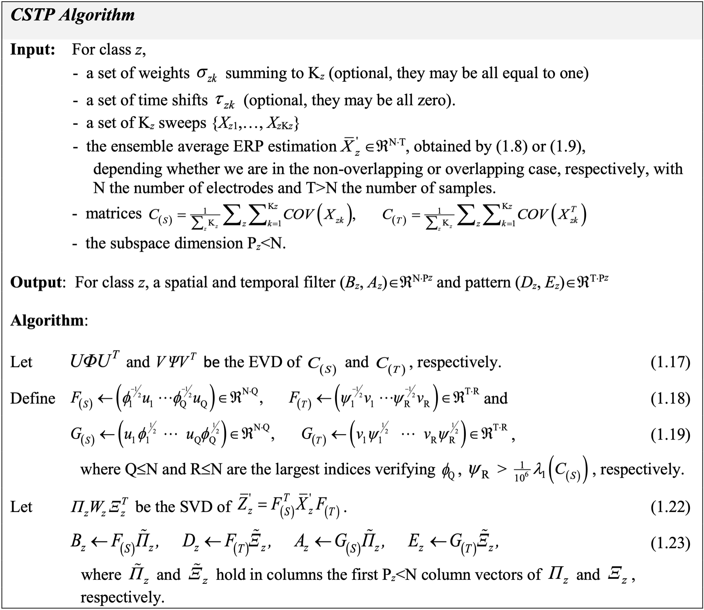
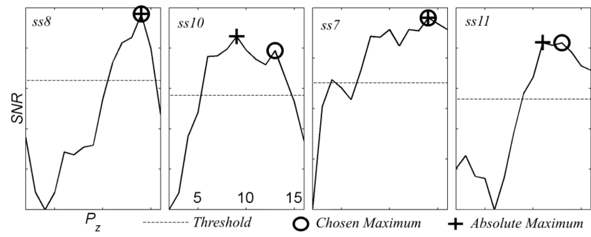
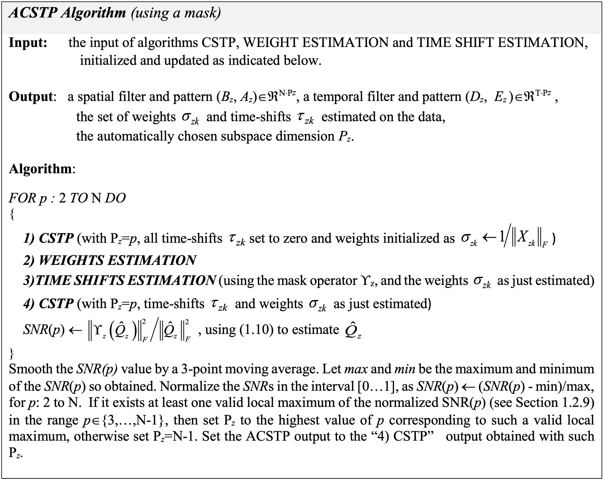
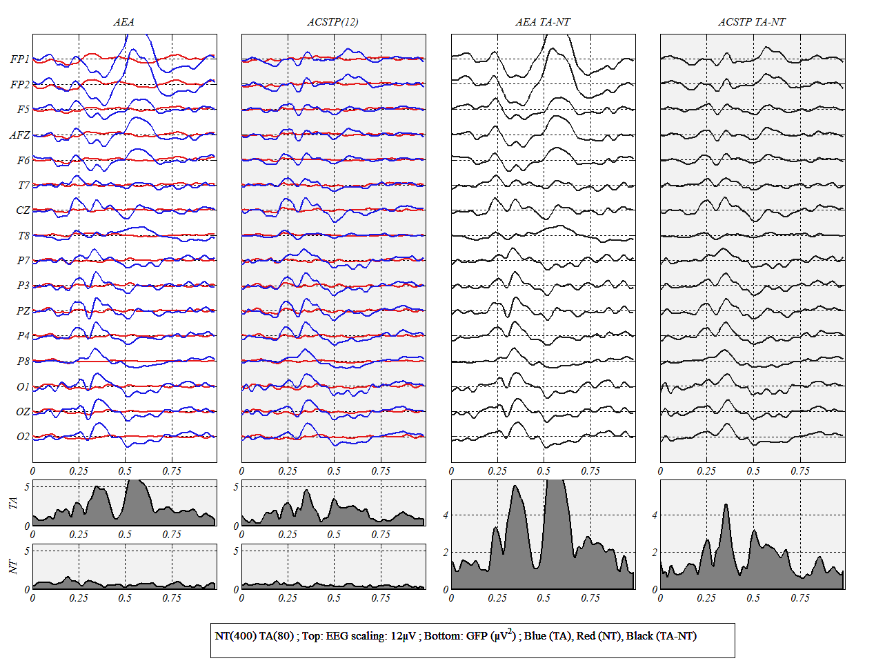
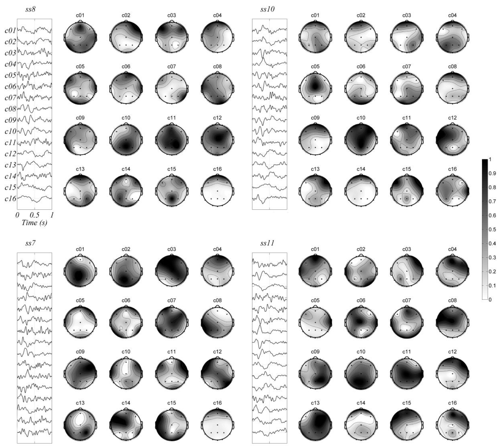
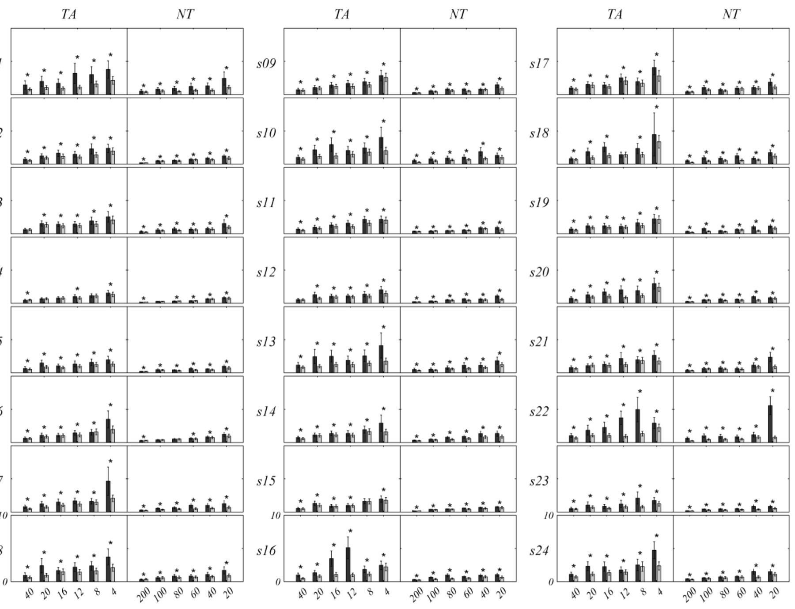
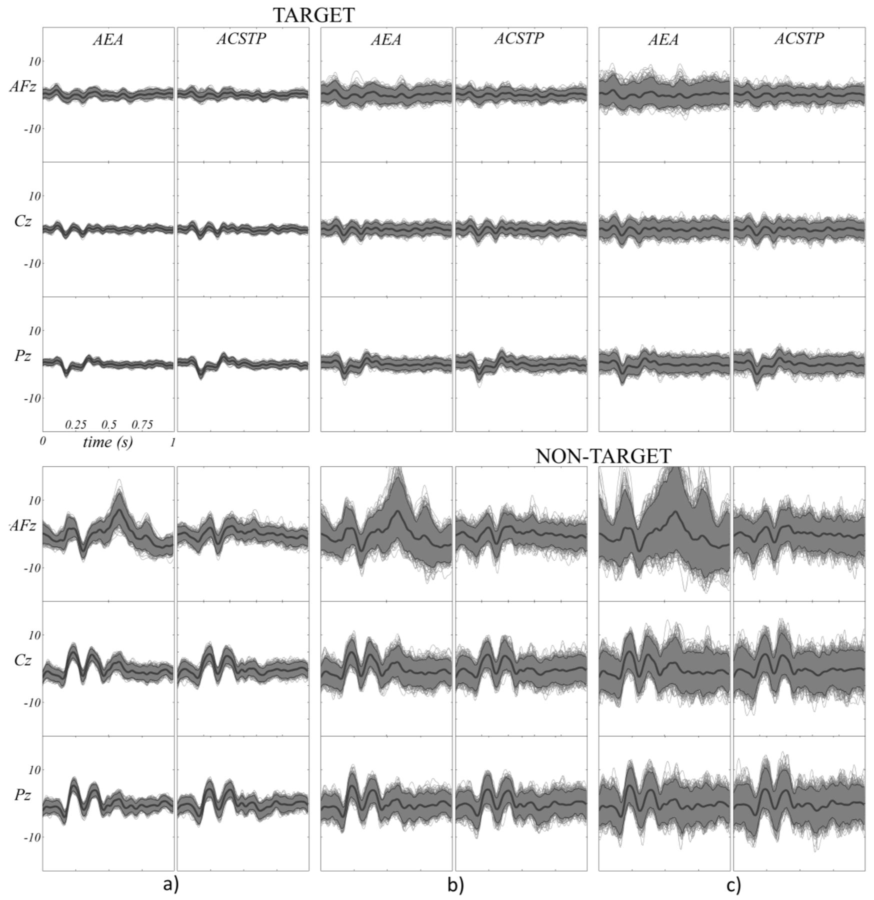

# ACSTP — Adaptive Common Spatio-Temporal Pattern

MATLAB code for **ACSTP**, a method to estimate **Event-Related Potentials (ERPs)** from EEG (or MEG) when the data are noisy, contain artifacts, and the ERPs may overlap in time. It is meant as a companion to the usual arithmetic ensemble average (AEA), not a replacement.

In one call, `ACSTP` combines four steps:

- **Regression-based averaging** of epochs that overlap in time (short inter-stimulus intervals).
- **Bilinear (spatio-temporal) filtering** of the average, with **automatic choice of the subspace dimension** from a user-defined spatio-temporal mask.
- **Single-trial latency (jitter) correction**, an improved Woody method.
- **Single-trial weighting** by an SNR estimate, which down-weights trials hit by artifacts.

This is the code behind:

> M. Congedo, L. Korczowski, A. Delorme, F. Lopes da Silva, **"Spatio-temporal common pattern: A companion method for ERP analysis in the time domain"**, *Journal of Neuroscience Methods* 267:74–88, 2016. [doi:10.1016/j.jneumeth.2016.04.008](https://doi.org/10.1016/j.jneumeth.2016.04.008) · [hal-01343026](https://hal.science/hal-01343026) · [PDF](https://hal.science/hal-01343026/document)


*Paper, Fig. 2. Arithmetic ensemble average (AEA, white panels) and ACSTP estimate (grey panels; the chosen subspace dimension is in brackets) of 80 target (top) and 400 non-target (bottom) sweeps for four subjects. The eye artifacts that survive averaging in subjects 8 and 10 (Fp1, Fp2) are removed by ACSTP. For clean subjects (7, 11) the two estimates are close. The shaded plots are the global field power.*

**New here? Start with the [step-by-step tutorial](TUTORIAL.md).** It walks through `tutorial/script_ACSTP_test.m` on the toy dataset, explains every option, and shows what the figures should look like, so you can follow it without MATLAB.

**Keywords:** EEG · MEG · ERP · event-related potentials · P300 · odd-ball · ensemble average · artifact removal · eye blinks · spatio-temporal filtering · bilinear filter · common spatial pattern (CSP) · xDAWN · latency correction · Woody · single-trial · trial weighting · overlapping ERPs · regression-based averaging · brain-computer interface (BCI) · MATLAB

---

## Contents

- [Why ACSTP](#why-acstp)
- [Model and algorithm](#model-and-algorithm)
- [Requirements and installation](#requirements-and-installation)
- [Quick start](#quick-start)
- [Function reference](#function-reference)
- [Results reported in the paper](#results-reported-in-the-paper)
- [Differences between the code and the paper](#differences-between-the-code-and-the-paper)
- [Known issues](#known-issues)
- [Repository layout](#repository-layout)
- [Authors, license and citation](#authors-license-and-citation)

---

## Why ACSTP

The ERP is usually estimated as the arithmetic mean of the sweeps (epochs) time-locked to the event. A single-sweep ERP is a few µV, while the ongoing EEG and artifacts are tens of µV, so the AEA:

- needs **many sweeps**, or a careful **manual rejection** of sweeps with artifacts;
- is **biased when ERPs overlap**, i.e. when the inter-stimulus interval is shorter than the ERP (fast odd-ball paradigms, BCI, eye-fixation potentials);
- ignores the **latency jitter** and the **amplitude variability** from sweep to sweep;
- treats every sweep the same, so a few sweeps with a blink or a movement can distort the average. This is what you see at Fp1/Fp2 in Fig. 2 above.

ACSTP keeps the averaging framework but adds a sharp spatio-temporal filter: a spatio-temporal PCA applied to data that has first been whitened by the noise covariance in space *and* in time. It also adapts a weight and a time shift for every sweep. The paper analyses 24 subjects **without any artifact rejection**. Compared to the AEA, it needs fewer sweeps for the same variability (Fig. 5 below). When the data are clean, the ACSTP estimate stays close to the AEA.

ACSTP is not a source separation method. The spatial and temporal patterns it finds (Fig. 4) maximize SNR. They should not be read as physiological sources.

---

## Model and algorithm

Notation follows the paper. `z = 1…Z` is the class (e.g. target / non-target), `k = 1…K_z` the sweep, `N` the number of electrodes and `T > N` the number of samples per sweep. All equation numbers refer to the paper.

### 1. Data model

For non-overlapping ERPs, sweep `k` of class `z` is a stereotyped response `Q_z` with its own amplitude `s_zk` and latency `t_zk`, plus noise (EEG, artifacts):

```math
X_{zk} = s_{zk}\, Q_z(t_{zk}) + N_{zk} \qquad (1.1)
```

For overlapping ERPs the whole continuous recording `X` (N × L samples) is modelled at once with Toeplitz "design" matrices `T_z` (T × L) that place each sweep, shifted and scaled, in the stream:

```math
X = Q_1 T_1 + \dots + Q_Z T_Z + N = Q\,T + N \qquad (1.2,\ 1.3)
```

Latencies and amplitudes are unknown, so ACSTP estimates a time shift `τ_zk` (integer, in samples) and a weight `σ_zk > 0` for every sweep, and works with the weighted, aligned sweeps

```math
X'_{zk} = \sigma_{zk}\, X_{zk}(\tau_{zk}) \qquad (1.4)
```

### 2. Ensemble average (unfiltered)

Without overlap, the weighted and aligned arithmetic mean is

```math
\bar X'_z = \frac{1}{K_z}\sum_{k} \sigma_{zk} X_{zk}(\tau_{zk}) \qquad (1.8)
```

With overlap, all class averages are estimated jointly by least-squares multivariate regression on the continuous data (extending Souloumiac & Rivet 2013):

```math
\left[\bar X'_1 \cdots \bar X'_Z\right] = X T^\top \left(T T^\top\right)^{-1}
\begin{bmatrix} j_1 I_T & & 0\\ & \ddots & \\ 0 & & j_Z I_T \end{bmatrix},
\qquad j_z = \frac{\sum_k \sigma_{zk}^2}{\sum_k \sigma_{zk}} \qquad (1.9)
```

When nothing overlaps, (1.9) reduces to (1.8) (paper, Appendix A). In the code this is `meanOverlap`: the weights sit on the non-zero diagonals of `T`, and the regression is used only when two consecutive epochs actually overlap.

### 3. CSTP: the bilinear filter (closed form)

**Noise covariances.** Spatial and temporal covariances are averaged over the single sweeps of *all* classes, so they hold the ongoing EEG and the artifacts, not only the evoked part:

```math
C_{(S)} = \frac{1}{\sum_z K_z}\sum_z\sum_k \mathrm{COV}(X_{zk}),\qquad
C_{(T)} = \frac{1}{\sum_z K_z}\sum_z\sum_k \mathrm{COV}(X_{zk}^\top) \qquad (1.12)
```

**Bilinear whitening.** With the eigen-decompositions `C_(S) = U Φ Uᵀ` and `C_(T) = V Ψ Vᵀ` (1.17):

```math
F_{(S)} = [\phi_1^{-1/2}u_1 \cdots \phi_Q^{-1/2}u_Q],\quad
F_{(T)} = [\psi_1^{-1/2}v_1 \cdots \psi_R^{-1/2}v_R] \qquad (1.18)
```
```math
G_{(S)} = [u_1\phi_1^{1/2} \cdots u_Q\phi_Q^{1/2}],\quad
G_{(T)} = [v_1\psi_1^{1/2} \cdots v_R\psi_R^{1/2}] \qquad (1.19)
```

`Q` and `R` drop only the near-null eigenvalues (see [differences](#differences-between-the-code-and-the-paper) for the exact threshold).

**Spatio-temporal PCA of the whitened average.** Take the SVD

```math
\bar Z'_z = F_{(S)}^\top\, \bar X'_z\, F_{(T)} = \Pi_z W_z \Xi_z^\top \qquad (1.21,\ 1.22)
```

and keep the first `P_z` singular vectors (`Π̃_z`, `Ξ̃_z`). Filters and patterns are then

```math
B_z = F_{(S)}\tilde\Pi_z,\quad D_z = F_{(T)}\tilde\Xi_z,\quad
A_z = G_{(S)}\tilde\Pi_z,\quad E_z = G_{(T)}\tilde\Xi_z \qquad (1.23)
```

`B_z` (N × P_z) holds spatial filters and `D_z` (T × P_z) temporal filters. `A_z` and `E_z` are the matching spatial and temporal patterns, with `B_zᵀA_z = D_zᵀE_z = I`. This solves the bilinear SNR maximization (1.14) in closed form, without iterations. Without the whitening it would be a plain bilinear PCA.


*Paper, CSTP algorithm box (Section 1.2.8).*

**Filtered estimates.** The ACSTP ensemble average and the single-sweep estimates are

```math
\hat Q_z = A_z B_z^\top\, \bar X'_z\, D_z E_z^\top \qquad (1.10)
```
```math
\hat X_{zk} = A_z B_z^\top\, X'_{zk}\, D_z E_z^\top = A_z B_z^\top\,\sigma_{zk}X_{zk}(\tau_{zk})\, D_z E_z^\top \qquad (1.4,\ 1.5,\ 1.7)
```

In the code: `Xhat(:,:,k) = As{c}*Bs{c}'*W(k)*X(:,:,k)*Bt{c}*At{c}'`, where `X(:,:,k)` is the latency-corrected epoch.

| Paper | Code (`ACSTPstruct`) | Size | Meaning |
|---|---|---|---|
| `B_z` | `Bs{z}` | N × P_z | spatial filters |
| `D_z` | `Bt{z}` | T × P_z | temporal filters |
| `A_z` | `As{z}` | N × P_z | spatial patterns (scalp maps) |
| `E_z` | `At{z}` | T × P_z | temporal patterns (time courses) |
| `P_z` | `BestPz(z)` | scalar | subspace dimension |
| `σ_zk` | `Weights(k)` | K × 1 | sweep weights |
| `τ_zk` | `Latency(k)` | K × 1 | sweep time shifts (samples) |
| `Q̂_z` | `EAcstp(:,:,z)` | N × T | filtered ensemble average |
| `ϒ_z` (mask) | `Mask_Electrodes` × `Mask_Time` | — | spatio-temporal mask |

### 4. Choosing the subspace dimension with a mask

`P_z` must be large enough to keep the ERP and small enough to remove noise. The user gives a **mask** `ϒ_z`: the electrodes and time samples where the ERP of interest is expected (for a visual P300: parietal/occipital electrodes, about 50–550 ms). For each candidate `p`, the share of the filtered average that falls inside the mask is

```math
\mathrm{SNR}(p) = \frac{\lVert \Upsilon_z(\hat Q_z) \rVert_F^2}{\lVert \hat Q_z \rVert_F^2} \qquad (1.15)
```

The curve is smoothed with a 3-point moving average. `P_z` is the **highest** `p` at a local maximum that reaches at least 66 % of the global maximum (a "valid local maximum").


*Paper, Fig. 3. Smoothed, normalized SNR (1.15) as a function of the subspace dimension for subjects 8, 10, 7 and 11. Dashed line: 66 % threshold. Cross: absolute maximum. Circle: the chosen value (the highest valid local maximum).*

### 5. Sweep weights

Given the filters, each sweep gets the ratio of its filtered part to what the filter removes:

```math
\sigma_{zk} = \frac{\lVert A_z B_z^\top X_{zk} D_z E_z^\top \rVert_F}{\lVert X_{zk} - A_z B_z^\top X_{zk} D_z E_z^\top \rVert_F}
\qquad (1.16),\qquad \text{then } \sigma_{zk} \leftarrow K_z\,\sigma_{zk}/\textstyle\sum_k\sigma_{zk}
```

A sweep with a large artifact has a large denominator, so it gets a small weight. The weights are initialized as `σ_zk = 1/‖X_zk‖_F` and normalized to mean 1 within each class.

### 6. Sweep latency correction

This is Woody's method with three improvements: covariance instead of correlation, filtered data instead of raw data, and a leave-one-out average. For each sweep `k` and each shift `ε` in `[-E, E]`:

```math
\bar Y_{z(\backslash k)} = \frac{1}{K_z-1}\sum_{i\neq k} B_z^\top \Upsilon_z(\sigma_{zi}X_{zi}) D_z,\qquad
Y_{zk(\varepsilon)} = B_z^\top \Upsilon_z(\sigma_{zk}X_{zk}(\varepsilon)) D_z
```
```math
\tau_{zk} = \text{valid local maximum of } \mathrm{tr}\!\left(Y_{zk(\varepsilon)}\bar Y_{z(\backslash k)}^\top\right) \text{ with the smallest } |\varepsilon| \text{ (0 if none)}
```

This repeats until the shifts stop changing or a maximum number of iterations is reached. `E` (`LatencyCorr_max`) depends on the instrumental jitter and on the ERP studied. The paper used ±4 samples at 128 Hz.

### 7. ACSTP: putting it together

For every candidate subspace dimension `p`:

1. CSTP with all `τ_zk = 0` and `σ_zk = 1/‖X_zk‖_F`;
2. weight estimation (1.16);
3. time-shift estimation, using the mask and the weights just estimated;
4. CSTP again with these weights and time shifts, and compute `SNR(p)` (1.15).

Then pick `P_z` from the `SNR(p)` curve and return the step-4 filters, weights and time shifts for that `P_z`.


*Paper, ACSTP algorithm box (Section 1.2.12).*

---

## Requirements and installation

- **MATLAB.** The old README says R2011b or later. The code is from 2015–2016, has no MEX files, and was tested by the author on Windows.
- **Signal Processing Toolbox**, for `findpeaks`. It is used to choose the subspace dimension (when you test 4 or more values) and in the latency correction (when `LatencyCorr_max > 0`). It is not bundled.
- **Curve Fitting Toolbox `smooth`:** not needed. A copy of `smooth.m` ships in `lib/compatibility/`.
- **EEGLAB (optional).** Only `ACSTPshow(...,3)` needs it, for the topographic maps (`readlocs`, `topoplot`). Electrode location files are in `data/loc/`. Put them on the path or copy them to EEGLAB's location folder.
- GNU Octave has not been tested.

**Install**

```matlab
% 1. download or clone https://github.com/lkorczowski/acstp
% 2. in MATLAB, from the repository folder:
installer        % adds the repository root, data/ and lib/ (with subfolders) to the path
```

You can also do it by hand: `addpath(genpath('lib')); addpath(genpath('data'));`.

## Quick start

```matlab
installer
load('EEG_ex.mat')                       % toy P300 data: struct EEG

opt.Epoch_size      = EEG.Fs;            % 1 s epochs (128 samples)
opt.LatencyCorr_max = 0;                 % no jitter correction (try 4)
opt.Mask_Electrodes = [7 9 10 11 12 13 14 15 16];          % Cz P7 P3 Pz P4 P8 O1 Oz O2
opt.Mask_Time       = floor(0.05*EEG.Fs):ceil(0.55*EEG.Fs); % ~50-550 ms
opt.SubspaceDim     = 16:-1:10;          % candidate P_z, in decreasing order
opt.computeClassLat = 1;                 % jitter correction for targets only

[Xhat, ACSTPfilter] = ACSTP(EEG, opt);   % Xhat: filtered epochs [16 x 128 x 480]

figure; ACSTPshow(EEG, opt, ACSTPfilter)     % AEA vs ACSTP, TA, NT, TA-NT
figure; ACSTPshow(EEG, opt, ACSTPfilter, 2)  % latency and weight histograms
```

This is what `tutorial/script_ACSTP_test.m` does. [TUTORIAL.md](TUTORIAL.md) explains each line. The figure below was produced by the author with `ACSTPshow` on this dataset:


*`ACSTPshow(EEG, ACSTPoptions, ACSTPfilter)` on `EEG_ex.mat` (author's figure, `pic/1output.PNG`). Columns: AEA, ACSTP (chosen P_z in brackets), AEA TA−NT, ACSTP TA−NT. Blue = target, red = non-target. The blink around 550 ms at FP1/FP2 in the target AEA is gone in the ACSTP estimate. Bottom: global field power.*

---

## Function reference

### `ACSTP`

```matlab
[Xhat, ACSTPstruct] = ACSTP(EEG, ACSTPoptions)
```

Both inputs are required. See [Known issues](#known-issues) for why a call with only `EEG` fails.

**`EEG` (struct, continuous data)**

| Field | Size | Meaning |
|---|---|---|
| `Fs` | scalar | sampling rate (Hz) |
| `Channels` | samples × channels | preprocessed continuous EEG. It is converted to `double`, and transposed if it has more rows than columns. |
| `Trigger` | samples × 1 | zeros, with a non-zero value at the **first sample of each epoch**. Only the positions are used. You can also give a vector of sample indices, one per epoch: ACSTP then converts it and warns. |
| `EpochClass` | epochs × 1 | class label of each epoch, in the order of `Trigger` (e.g. 0 = non-target, 1 = target) |
| `NoiseTrigger` *(optional)* | samples × 1, or indices | epoch onsets used **only** for the noise covariances (1.12). Default: the same as `Trigger`. |
| `ElectrodesName` *(optional)* | 1 × channels cell | electrode labels, used in figures |

Epochs start **at** the trigger: there is no pre-stimulus window. If you want a baseline period, move the triggers earlier and widen `Epoch_size` and `Mask_Time` to match (a comment in the code suggests this).

**`ACSTPoptions` (struct)**

| Field | Default | Meaning |
|---|---|---|
| `Epoch_size` | **required** | epoch length `T` in samples. It must be larger than the number of channels. |
| `LatencyCorr_max` | `0` | maximum time shift `E` in samples (±). `0` turns latency correction off. Every trigger must be at least `E` samples away from the start and the end of the recording. |
| `Mask_Electrodes` | all channels | channel indices of the mask. Used to choose `P_z` and in latency correction. |
| `Mask_Time` | `1:Epoch_size` | sample indices (within the epoch) of the mask |
| `SubspaceDim` | `N:-1:N/2` | candidate subspace dimensions, **in decreasing order**, each between 1 and N. Use one value to fix `P_z`, or three or more to let ACSTP choose (see [Known issues](#known-issues) about exactly two values). |
| `MaxIterLatency` | `10` | maximum number of latency iterations |
| `computeClassLat` | all classes | the classes whose latencies are estimated. Latency correction is the slowest step, so skip the classes that don't need it. |
| `Weights` | `true` | `true`: estimate weights (1.16). `false`: all weights are 1. A K × 1 vector: use these weights as given (ACSTP warns). |
| `overlap` | `1` | `1`: regression average (1.9) when epochs overlap. `0`: always the arithmetic mean (1.8). The regression is turned off anyway when `Epoch_size × nb classes > 1024`. |
| `DISPLAY` | `0` | not implemented: it only prints a message. Use `ACSTPshow`. |

**Outputs**

- `Xhat` [N × T × K]: single-sweep estimates `A_z B_zᵀ σ_k X_k(τ_k) D_z E_zᵀ`, i.e. latency-corrected, weighted and filtered (1.7). The epochs are in trigger order.
- `ACSTPstruct`:

| Field | Meaning |
|---|---|
| `EA` | plain arithmetic ensemble average, N × T × Z, unweighted, unaligned, **no** overlap correction (the "AEA" of the figures) |
| `EAoverlap` | unweighted ensemble average from `meanOverlap`: regression (1.9) if the epochs overlap |
| `EAcstp` | ACSTP ensemble average `Q̂_z` (1.10), N × T × Z: weighted, aligned, overlap-corrected and filtered |
| `Bs`, `Bt`, `As`, `At` | 1 × Z cells: spatial filters, temporal filters, spatial patterns, temporal patterns for the chosen `P_z` of each class |
| `fullBs`, `fullBt`, `fullAs`, `fullAt` | the same, keeping all components (used for display, e.g. topoplots) |
| `BestPz` | chosen subspace dimension per class |
| `PzSNR` | the mask SNR for every tested `SubspaceDim` (last class), after 3-point smoothing and subtraction of its minimum (raw if only one value is tested) |
| `Weights` | K × 1 weights `σ_k` (mean 1 within each class) |
| `Latency` | K × 1 time shifts `τ_k` in samples (0 when not estimated) |
| `Class` | sorted class labels: the order of the 3rd dimension and of the cells |

### `ACSTPshow`

```matlab
ACSTPshow(EEG)                                  % check the data: overlap-corrected averages of classes 0 and 1
ACSTPshow(EEG, ACSTPoptions, ACSTPfilter)       % Type 1 (default)
ACSTPshow(EEG, ACSTPoptions, ACSTPfilter, Type)
```

| Call | What it draws |
|---|---|
| `ACSTPshow(EEG)` | the regression-based average (`meanOverlap`, 1 s epochs) of class 0 (red) and class 1 (blue), overlaid, all channels. Use it to check the data and to choose the masks. |
| `Type = 1` | four columns: AEA, ACSTP, AEA TA−NT, ACSTP TA−NT. Under each, the global field power, computed as the RMS over channels. |
| `Type = 2` | histograms of the latencies of NT and TA, and of all the weights |
| `Type = 3` | for each class, the temporal patterns `fullAt` and the scalp maps of `fullAs` (absolute values, normalized). **Needs EEGLAB.** |

Types 1–2 and the one-input call assume **two classes labelled 0 and 1**.

### `meanOverlap`

```matlab
[Emean, Class] = meanOverlap(E, Flash, Window, TAG, Weights, doregression)
```

Ensemble average of possibly overlapping epochs, (1.8)/(1.9). `E` is channels × samples (note: the transpose of `EEG.Channels`). `Flash` marks the epoch onsets (only the positions are used). `TAG` gives the class of each epoch, `Weights` the weight of each epoch, and `doregression` (default 1) allows the regression. It returns `Emean` (channels × Window × classes) and `Class` (sorted labels). `ACSTP` uses a nested copy of the same function. This file serves `ACSTPshow(EEG)` and direct calls.

### `plotEEG`

```matlab
h = plotEEG(sig, Scale, fs, LABELS, FontSize, Color, Marker, LineStyle, LineWidth)
```

Stacked plot of a channels × samples matrix (first channel on top, positive up). `Scale` is half the vertical space per channel. `fs` sets the time axis (default 128 Hz). `LABELS` are the channel names. All arguments after `sig` are optional; pass `[]` to keep a default.

### `installer`

Adds the repository root, `data/` and `lib/` (with their subfolders) to the MATLAB path, then prints its own help.

---

## Results reported in the paper

Data: 24 subjects, Brain Invaders P300 odd-ball (80 target and 400 non-target flashes per subject). 16 electrodes (FP1, FP2, F5, AFz, F6, T7, Cz, T8, P7, P3, Pz, P4, P8, O1, Oz, O2), referenced to the left ear-lobe. Notch-filtered at 50 Hz, band-passed 1–20 Hz with a zero-phase filter, downsampled from 512 to 128 Hz. **No artifact rejection.** Maximum time shift ±4 samples. Five masks covered all 24 subjects:

| Subjects | Mask electrodes | Mask time (ms) |
|---|---|---|
| 1, 8, 9, 10, 13, 15, 19, 20, 21 | Cz, P7, P3, Pz, P4, P8, O1, Oz, O2 | 50–550 |
| 6, 7, 22, 23 | FP1, FP2, AFz, F3, F4, Cz, P7, P3, Pz, P4, P8 | 50–550 |
| 2, 3, 5, 11, 14, 17, 18 | FP1, FP2, AFz, F3, F4, Cz, P7, P3, Pz, P4, P8, O1, Oz, O2 | 50–550 |
| 4, 12, 16 | Cz, P7, P3, Pz, P4, P8 | 50–550 |
| 24 | T7, Cz, T8, P7, P3, Pz, P4, P8 | 50–550 |

*(Paper, Table 1. The table says F3/F4, while the electrode list in the text says F5/F6.)*


*Paper, Fig. 4. The 16 temporal patterns (columns of `E`, time series) and spatial patterns (columns of `A`, scalp maps normalized to their maximum) for subjects 8, 10, 7 and 11. For subject 8, `P_z = 14`, so components 15–16 (very slow drifts) are removed. For subject 10, `P_z = 13`, so components 14–16 are removed; they peak at the frontal pole and are most likely eye-related.*


*Paper, Fig. 5. Variability of the estimators: mean and 3 SD of the RMSE over 600 bootstrap resamples, by bootstrap sample size (target: 40 down to 4 sweeps; non-target: 200 down to 20). Dark grey = AEA, light grey = ACSTP. Asterisk = significant difference (paired t-test, FDR q = 0.05). ACSTP has a lower RMSE in all subjects, and the gap grows as fewer sweeps are used.*


*Paper, Fig. 6. 600 bootstrapped ERPs (thin lines), their mean and 95 % interval at AFz, Cz and Pz for subject 8, using a) 50 %, b) 20 % and c) 10 % of the sweeps. The eye artifact near 500 ms at AFz in the target class is strongly reduced by ACSTP, even with 8 sweeps. Note: the caption and the text put the target class on top, but the in-figure labels "TARGET"/"NON-TARGET" seem swapped; the artifact and the larger spread appear in the lower block.*

---

## Differences between the code and the paper

These come from reading `lib/ACSTP.m` next to the paper. Nothing was run, because no MATLAB licence was available.

- **Whitening threshold.** The paper keeps the eigenvalues larger than `λ₁(C_(S))/10⁶` (CSTP box; "one million times smaller" in Appendix B). The code keeps the leading eigenvectors until their cumulative eigenvalue sum reaches `(1 − 10⁻¹²)` of the total, separately for space and time.
- **Candidate subspace dimensions.** The paper scans `p = 2…N` and chooses in `{3,…,N−1}`. The code scans only the values in `SubspaceDim` (default `N` down to `N/2`). When the list has three or more values, it never picks the first or the last one.
- **SNR used for `P_z`.** The paper uses the ratio of *squared* Frobenius norms (1.15). The code (`best_Pz`) uses the ratio of the norms themselves, so the 66 % threshold applies to the square root of the paper's SNR. Normalization: the paper uses `(SNR − min)/max`, while the code subtracts the minimum only. The threshold is relative, so this second difference has no effect.
- **Fallback for `P_z`.** If there is no valid local maximum, the paper sets `P_z = N − 1`. The code takes the maximum of the smoothed SNR over the inner values of the list.
- **Latency search range.** The paper evaluates shifts in `{−E−1,…,E+1}` so that a peak at `±E` can be detected. The code evaluates `−E…E`, and `findpeaks` cannot return an end point, so shifts of exactly `±E` are never chosen.
- **Latency mask.** The paper applies the mask (optionally) to both the leave-one-out average and the lagged sweep. The code masks only the lagged sweep. The leave-one-out average is computed from the current, already-shifted, weighted sweeps, without a mask.
- **Latency stopping rule.** The paper stops when `Σ_k |τ_zk| < E`, or after `i` iterations (suggested `i = 2E`). The code stops after at least two iterations when `mean_k |τ_new − τ_old| < E / K₁`, where `K₁` is the number of epochs whose label is non-zero, or after `MaxIterLatency` iterations (default 10).
- **Noise covariances.** These match (1.12): `cov` of each original, unweighted, unshifted epoch, averaged over all classes. The code also lets you use other segments (`EEG.NoiseTrigger`). The paper recommends random EEG segments when there are few sweeps (about 40 s of EEG is enough).
- **Regression average.** This matches (1.9), but the code builds the dense Toeplitz matrix and uses `pinv`, and turns the regression off when `Epoch_size × nb classes > 1024`. The paper notes that `XTᵀ` and `TTᵀ` can be computed without storing `T`, using sparse algebra. The code doesn't do that.
- **One `P_z` per class, but shared weights and latencies.** The paper runs the whole procedure per class. The code runs it once for all classes for each candidate dimension, chooses `P_z` per class, and then returns the `Weights` and `Latency` obtained with the `P_z` of the **last** class.
- **Global field power.** The paper (footnote 5) defines GFP as the average absolute amplitude across channels. `ACSTPshow` plots the RMS across channels and labels it µV².

## Known issues

These come from reading the code. They have not been re-run.

- **`installer.m`** looks for `external/` and `scripts/` folders that are not in the repository. Nothing is added from them. MATLAB may print a warning about the missing folders. It also puts `lib/compatibility/smooth.m` on the path, which shadows the Curve Fitting Toolbox `smooth` if you have it.
- **Signal Processing Toolbox** (`findpeaks`) is required but not checked or bundled. Without it, ACSTP fails as soon as it tests 4 or more subspace dimensions, or when `LatencyCorr_max > 0`.
- **`ACSTP(EEG)` with one input fails.** `ACSTPoptions` is read (`isfield(ACSTPoptions,...)`) before the `nargin < 2` branch. That branch's defaults are also hard-coded for 16 channels at 128 Hz.
- **`SubspaceDim` with exactly two values** makes `best_Pz` return an empty index and ACSTP errors. Use one value, or three or more.
- **Several classes:** latency estimation uses the filters of the *last* class (`Bs(end)`, `Bt(end)`) for every class in `computeClassLat`. The returned `Weights`/`Latency` are those of the last class's best `P_z` (see above). Also, the latency call passes `Bt(end)` where `At` is expected; `At` is not used inside, so this has no effect. The tutorial notes that more than 2 classes were never tested.
- **`ACSTPshow`** Types 1–2 and the one-input call hard-code two classes labelled 0 and 1. The one-input call also assumes `EEG.Channels` is samples × channels and 1-s epochs. Type 3 has room for 16 scalp maps, so it will error with more than 16 channels. It needs `Standard-10-20-Cap81.locs` on the path and electrode names found in that file.
- **Encoding.** `lib/ACSTPshow.m` is saved in Latin-1/Windows-1252 (the `µ` in figure annotations). On a MATLAB that reads source files as UTF-8 (the default on macOS/Linux in recent releases), the `µ` displays garbled. This is cosmetic.
- **Line endings.** All `.m` files use Windows CRLF line endings. MATLAB doesn't care, but some diff tools show it.
- **Console noise.** `MaxIterLatency` is assigned without a semicolon, so its value is printed. `DISPLAY` does nothing.
- **Off-by-one check:** for `NoiseTrigger`, an epoch that ends exactly on the last sample is rejected (`+Window` instead of `+Window-1`).
- **Toy data:** `EEG_ex.mat` is a MATLAB v7.3 (HDF5) file. Its first ~1,560 samples, before the first trigger, contain a very large filtering transient (up to ~6·10⁷). Epochs taken at the triggers don't touch it, but the tutorial's optional "random noise epochs" test (TEST1) can.
- **No license file** in the repository (see below).

---

## Repository layout

```
installer.m                  adds the toolbox to the MATLAB path
lib/ACSTP.m                  the method (all steps as nested functions)
lib/ACSTPshow.m              figures (averages, latencies/weights, topoplots)
lib/meanOverlap.m            (regression-based) ensemble average
lib/plotEEG.m                stacked multichannel plot
lib/compatibility/smooth.m   copy of MATLAB smooth (no Curve Fitting Toolbox needed)
tutorial/script_ACSTP_test.m tutorial script
data/EEG_ex.mat              toy P300 dataset (16 ch, 128 Hz, 80 TA + 400 NT)
data/loc/                    EEGLAB electrode location files
pic/                         figures used in this README
```

## Authors, license and citation

Code by Louis Korczowski (GIPSA-lab, Univ. Grenoble Alpes, CNRS), 2015–2016. Method by Marco Congedo, Louis Korczowski, Arnaud Delorme and Fernando Lopes da Silva. Partly supported by ERC-2012-AdG-320684-CHESS. Contact: louis.korczowski@gmail.com.

**License:** the repository has no license file. Until one is added, ask the author before reusing the code beyond academic evaluation. The figures in `pic/` named `fig*` and `*_algorithm_box` are taken from the paper (HAL preprint). `pic/toy_ensemble_averages.png` is a plot of the toy data made for the tutorial. `lib/compatibility/smooth.m` is a copy of a MathWorks function.

If you use this code, please cite the paper (a [`CITATION.cff`](CITATION.cff) is included):

```bibtex
@article{congedo2016acstp,
  title   = {Spatio-temporal common pattern: A companion method for {ERP} analysis in the time domain},
  author  = {Congedo, Marco and Korczowski, Louis and Delorme, Arnaud and Lopes da Silva, Fernando},
  journal = {Journal of Neuroscience Methods},
  volume  = {267},
  pages   = {74--88},
  year    = {2016},
  doi     = {10.1016/j.jneumeth.2016.04.008},
  url     = {https://hal.science/hal-01343026}
}
```
