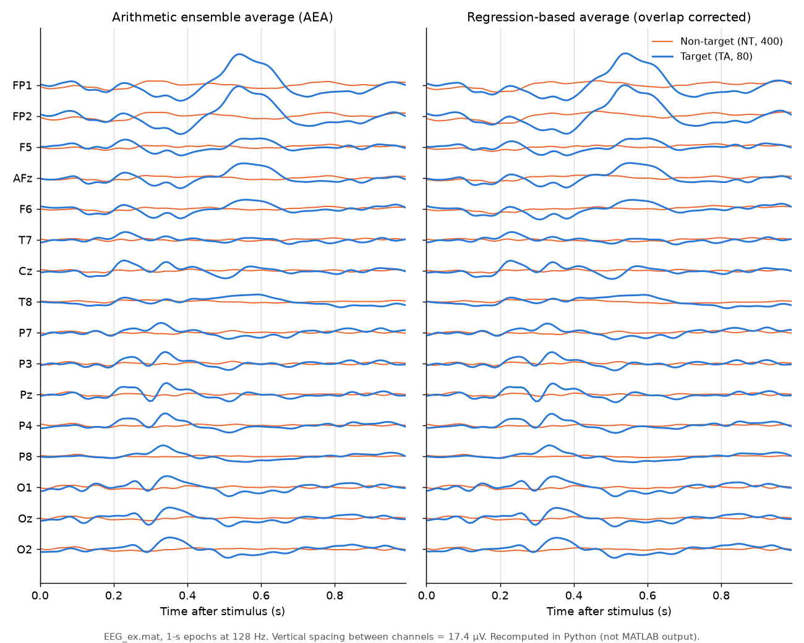
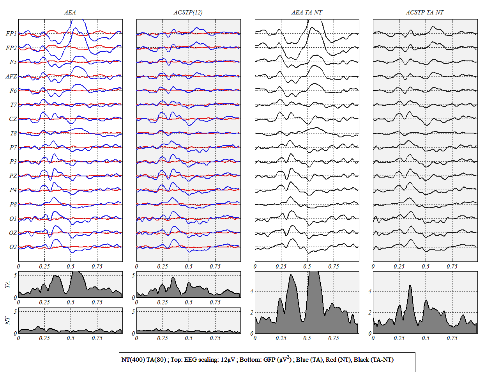
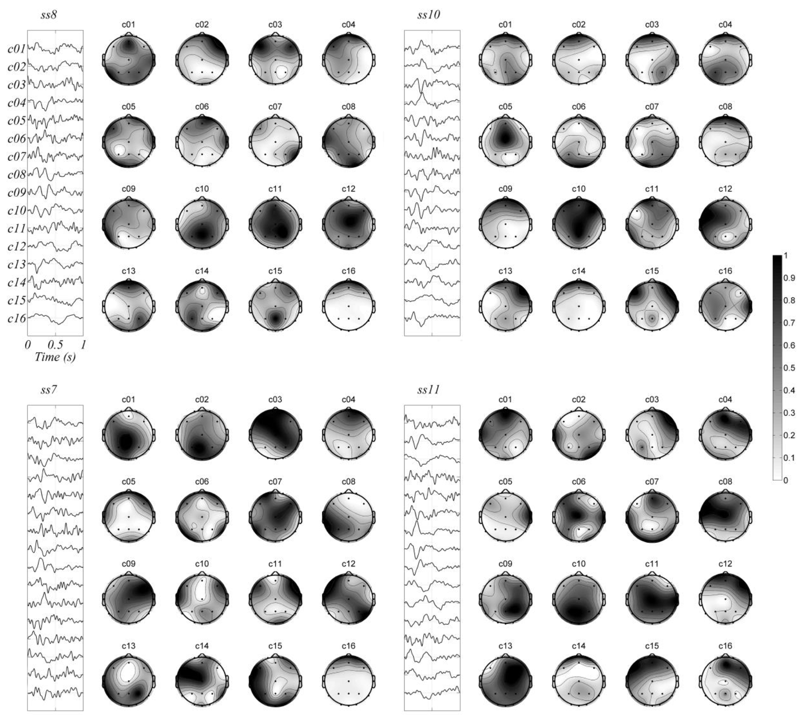

# ACSTP tutorial

This page walks through [`tutorial/script_ACSTP_test.m`](tutorial/script_ACSTP_test.m) step by step: the data format, the options, what each figure shows and what you should expect. After that, it explains how to prepare your own data and how to choose the masks and the subspace dimensions.

The method itself (equations, notation) is described in the [README](README.md#model-and-algorithm). Equation numbers such as (1.15) refer to the paper:

> M. Congedo, L. Korczowski, A. Delorme, F. Lopes da Silva, "Spatio-temporal common pattern: A companion method for ERP analysis in the time domain", *J. Neurosci. Methods* 267:74–88, 2016. [hal-01343026](https://hal.science/hal-01343026/document)

> **Note on this page.** It was written from the code, the paper and the figures in `pic/`. It was not re-run in MATLAB. The toy-data figure in step 0 was recomputed in Python from `EEG_ex.mat`. The other figures are the author's own `ACSTPshow` output or figures from the paper.

---

## Contents

- [Step 0 — Install and load the toy data](#step-0--install-and-load-the-toy-data)
- [Step 1 — Look at the data before filtering](#step-1--look-at-the-data-before-filtering)
- [Step 2 — Set the options](#step-2--set-the-options)
- [Step 3 — (Optional) choose where the noise is estimated](#step-3--optional-choose-where-the-noise-is-estimated)
- [Step 4 — Run ACSTP](#step-4--run-acstp)
- [Step 5 — Read the figures](#step-5--read-the-figures)
- [Step 6 — Use the outputs](#step-6--use-the-outputs)
- [Step 7 — Go further](#step-7--go-further)
- [Preparing your own data](#preparing-your-own-data)
- [Choosing the masks, SubspaceDim and LatencyCorr_max](#choosing-the-masks-subspacedim-and-latencycorr_max)

---

## Step 0 — Install and load the toy data

```matlab
installer                 % from the repository root: adds data/ and lib/ to the path
load('EEG_ex.mat')        % creates the struct EEG
```

`installer` adds `data/` and `lib/` to the MATLAB path, so `EEG_ex.mat` is found from any folder. The script also runs `clc`, `close all` and `clear all`, so save your workspace first.

`EEG_ex.mat` is a visual P300 odd-ball recording in the same format as the paper's Brain Invaders data (Section 1.2.13):

| Field | Value in `EEG_ex.mat` |
|---|---|
| `EEG.Fs` | 128 Hz |
| `EEG.Channels` | 32 576 samples × 16 channels (about 4 min 15 s), double |
| `EEG.ElectrodesName` | `FP1 FP2 F5 AFz F6 T7 Cz T8 P7 P3 Pz P4 P8 O1 Oz O2` (channel 1 to 16) |
| `EEG.Trigger` | 32 576 × 1 vector of zeros, with a 1 at the onset of each of the 480 flashes |
| `EEG.EpochClass` | 480 labels: **400 × 0 (non-target, NT)** and **80 × 1 (target, TA)** |

The interval between two consecutive flashes ranges from 20 samples (156 ms) to 554 samples. The median is 48 samples (375 ms). With 1-s epochs (128 samples), **almost every epoch overlaps the next ones**, which is why ACSTP uses the regression average (1.9) here.

The script names two sizes:

```matlab
N = size(EEG.Channels,2);   % number of electrodes (16)
T = size(EEG.Channels,1);   % number of samples of the continuous recording
```

The file is MATLAB v7.3 (HDF5). Its first ~1 560 samples, before the first flash at sample 2 726, contain a very large filtering transient. Epochs taken at the flashes don't include it.

## Step 1 — Look at the data before filtering

```matlab
figure
ACSTPshow(EEG)
```

With a single input, `ACSTPshow` computes the overlap-corrected average (`meanOverlap`) of 1-s epochs for class 0 (red) and class 1 (blue) and overlays them on all channels. This check comes first, for two reasons:

- if the struct is wrong (orientation, triggers, labels), you will see it here;
- **the masks you choose in step 2 come from this figure.**

The same averages, recomputed in Python from `EEG_ex.mat`, look like this:


*`EEG_ex.mat`: arithmetic average (left) and regression-based, overlap-corrected average (right, the one `ACSTPshow(EEG)` draws) of the 80 target (blue) and 400 non-target (orange) 1-s epochs. Recomputed in Python with the same formula as `meanOverlap`. This is not MATLAB output, and `ACSTPshow` uses red for non-target.*

The script draws two observations from it:

1. **A blink distorts the target average at the frontal electrodes** (FP1, FP2, and to a lesser extent F5, AFz, F6), with a large positive wave peaking around 550 ms. → *Do not put the frontal electrodes in the spatial mask.*
2. **The target ERP is mostly parieto-occipital**, with its largest deflections between about 100 and 500 ms (around 300 ms) at Cz, P7, P3, Pz, P4, P8, O1, Oz, O2. → *Put these electrodes in the spatial mask, and use a time mask slightly wider than the ERP: 50–550 ms.*

Comparing the two panels shows the effect of the overlap correction. The shapes are similar, but the regression removes the part of the neighbouring flashes' responses that leaks into each epoch. In this dataset the two estimates of the target average differ by up to about 2 µV.

## Step 2 — Set the options

```matlab
ACSTPoptions.Epoch_size      = 1*EEG.Fs;   % epoch length: 128 samples = 1 s
ACSTPoptions.LatencyCorr_max = 0;          % max jitter correction in samples (0 = off)

ACSTPoptions.Mask_Electrodes = [7,9,10,11,12,13,14,15,16];   % Cz P7 P3 Pz P4 P8 O1 Oz O2
ACSTPoptions.Mask_Time       = floor(0.05*EEG.Fs):ceil(0.55*EEG.Fs);  % samples 6..71

ACSTPoptions.computeClassLat = 1;          % estimate latencies for targets only
ACSTPoptions.SubspaceDim     = N:-1:N-6;   % try P = 16, 15, ..., 10
```

| Option | Value here | What it does |
|---|---|---|
| `Epoch_size` | 128 | Each epoch runs from the trigger to 1 s after it, with no pre-stimulus part. It must be larger than the number of channels (the paper assumes T > N). |
| `LatencyCorr_max` | 0 | Maximum shift ±E for the jitter correction. **It is 0 in the script, so latency correction is off** and `computeClassLat` is ignored. Set it to e.g. 4 to turn it on; the paper used ±4 samples at 128 Hz. |
| `Mask_Electrodes` | channels 7, 9–16 | The spatial part of the mask `ϒ`. It is the same as the paper's mask for 9 of the 24 subjects (README, Table 1). |
| `Mask_Time` | samples 6–71 | The temporal part of the mask. Sample 1 is the trigger, so this is about 40–550 ms. |
| `computeClassLat` | 1 | Estimate latencies only for class 1 (target). This is the slowest step, and non-targets usually don't need it. |
| `SubspaceDim` | 16:-1:10 | The candidate `P` values, **in decreasing order**. ACSTP runs the full loop (weights → latencies → filters) for each one, then picks one per class from the mask SNR (1.15). With 7 candidates, only 15…11 can be chosen: the first and last values are never selected. |

You can also leave these options at their defaults: `Weights` (true, estimate the weights), `overlap` (1, use the regression when epochs overlap) and `MaxIterLatency` (10). The README's [option table](README.md#acstp) lists them all.

**Fixed subspace dimension.** The script also shows `ACSTPoptions.SubspaceDim = N-3;`. With a single value no search is done, and the CSTP keeps `P = 13` components for every class. Do not give exactly two values: that case errors (README, Known issues).

## Step 3 — (Optional) choose where the noise is estimated

The filters whiten the data with the **noise** covariances (1.12), estimated by default from the very same epochs. The script has four commented-out alternatives, set through `EEG.NoiseTrigger`:

| Test | Code | Expected effect (per the script's comments) |
|---|---|---|
| TEST1 | `NoiseTrigger` = 480 random positions in the recording | "much worse", because random segments are not stimulus-locked like the ERP epochs. In this file a random epoch can also fall into the large transient at the very start (step 0). |
| TEST2 | `NoiseTrigger` = target onsets only | noise from TA epochs only |
| TEST3 | `NoiseTrigger` = non-target onsets only | noise from NT epochs only |
| TEST4 | `NoiseTrigger = []` | default: all epochs. The script calls it "Standard (performance should be the best)". |

TEST2/3 give `NoiseTrigger` as a list of sample indices, not a 0/1 vector. ACSTP accepts that, converts it and prints `ACSTP WARNING2b`. The paper's discussion suggests random EEG segments as extra noise data when **few sweeps** are available. About 40 s of EEG is enough.

## Step 4 — Run ACSTP

```matlab
[EEG.EpochsACSTP, ACSTPfilter] = ACSTP(EEG, ACSTPoptions);
```

For each value in `SubspaceDim`, ACSTP:

1. cuts the epochs and initializes every weight to `1/‖X_k‖_F` (normalized to mean 1 per class);
2. computes the weighted, overlap-corrected average (1.9);
3. computes the CSTP filters: noise covariances (1.12), bilinear whitening (1.17–1.19), SVD of the whitened average (1.21–1.22) and the first `P` components (1.23);
4. re-estimates the weights from the filtered/residual energy of each epoch (1.16);
5. *(only if `LatencyCorr_max > 0`)* estimates the latency of each epoch of the classes in `computeClassLat`, and re-cuts and re-averages the epochs;
6. recomputes the CSTP filters with these weights and latencies, and stores the filtered average.

It then chooses `BestPz` for each class from the mask SNR curve. Finally it applies the latencies, weights and filters to every epoch to produce `Xhat`.

On the console you should see `ACSTP INFO` lines: weights computed (1), latency estimation (0 here), then a progress line per candidate dimension. With `LatencyCorr_max > 0` it also prints which classes get latency correction. If you set `MaxIterLatency`, its value is echoed too (a missing semicolon).

What you get:

- `EEG.EpochsACSTP`: 16 × 128 × 480, the filtered single-trial estimates (1.7), weighted and, if enabled, latency-corrected;
- `ACSTPfilter`: the filters, patterns, chosen `BestPz`, `Weights`, `Latency`, and three averages: `EA` (plain arithmetic mean), `EAoverlap` (regression mean) and `EAcstp` (the ACSTP estimate). See the README's [output table](README.md#acstp).

## Step 5 — Read the figures

### Type 1: the ensemble averages

```matlab
figure
ACSTPshow(EEG, ACSTPoptions, ACSTPfilter)
```


*Author's output of `ACSTPshow` Type 1 on `EEG_ex.mat`. The exact options of that run are not recorded, so your chosen dimension may differ.*

- **Column 1, "AEA":** the plain arithmetic average (`ACSTPfilter.EA`). Blue = TA, red = NT. The blink at FP1/FP2 around 550 ms dominates the frontal target traces.
- **Column 2, "ACSTP(P)":** the ACSTP estimate (`EAcstp`). `P` in the title is the subspace dimension chosen for the target class (12 in the author's run). The frontal blink is gone, while the early components at Cz and the parietal/occipital P300 are kept.
- **Columns 3–4:** the TA − NT difference, before and after ACSTP.
- **Bottom rows:** global field power (RMS over channels) for TA and NT, or for the difference. The large GFP peak near 550 ms in the AEA target comes from the blink. It disappears with ACSTP, and the peaks around 250–350 ms remain.

This is the same behaviour the paper reports for its subjects 8 and 10 (README, Fig. 2): eye artifacts that survive averaging are removed, and cerebral peaks are kept.

### Type 2: latencies and weights

```matlab
figure
ACSTPshow(EEG, ACSTPoptions, ACSTPfilter, 2)
```

Three histograms: latencies of the NT epochs, latencies of the TA epochs (in samples, from −E to +E), and the weights of all epochs.

- With the script's settings (`LatencyCorr_max = 0`), **both latency histograms are a single bar at 0**. Set `LatencyCorr_max = 4` to see a spread of TA latencies. NT latencies stay at 0 because `computeClassLat = 1`.
- The weights have mean 1 within each class. Epochs with large artifacts get small weights: the filter removes most of their energy, so the denominator of (1.16) is large.

### Type 3: the spatial and temporal patterns (EEGLAB)

```matlab
if exist('readlocs')
    ACSTPshow(EEG, ACSTPoptions, ACSTPfilter, 3)
end
```

This needs EEGLAB and `Standard-10-20-Cap81.locs` (copy it from `data/loc/` to EEGLAB's location folder if needed). You get one figure per class: the temporal patterns (columns of `fullAt`) as time series, and the spatial patterns (columns of `fullAs`) as scalp maps. These are all 16 components, including the ones removed by the subspace reduction. Components above `BestPz` are the ones filtered out. In the paper (Fig. 4, below) they are typically slow drifts or frontal, eye-related activity.


*Paper, Fig. 4: the same kind of display for four subjects of the paper's dataset. For subject 8, `P = 14`, so components 15–16 are removed.*

These patterns maximize SNR. They are **not** physiological sources (paper, Discussion).

## Step 6 — Use the outputs

```matlab
TA  = find(ACSTPfilter.Class == 1);
ERP = ACSTPfilter.EAcstp(:,:,TA);                 % 16 x 128 ACSTP target ERP
figure; plotEEG(ERP, [], EEG.Fs, EEG.ElectrodesName');

% single-trial estimates of the targets
XhatTA = EEG.EpochsACSTP(:,:,EEG.EpochClass == 1);

% apply the target filter yourself to an epoch X (16 x 128):
% Xf = ACSTPfilter.As{TA}*ACSTPfilter.Bs{TA}'*X*ACSTPfilter.Bt{TA}*ACSTPfilter.At{TA}';
```

For classification (e.g. BCI), estimate the filters on training data only. `ACSTP` uses every epoch you give it, including the class labels, to build the filters.

## Step 7 — Go further

The script ends with three suggestions:

- **A narrower time mask**, e.g. 250–350 ms. It focuses on the P300 and should estimate it better, but you may lose the earlier N2/P2 complex.
- **Other spatial masks**, e.g. the paper's other four masks (README, Table 1).
- **Turn on jitter correction:** `LatencyCorr_max = 4` (the paper's value) or more. The script suggests up to 15 samples, which is about 117 ms at 128 Hz.

To mimic the paper's automatic search more closely, scan more dimensions, e.g. `SubspaceDim = N:-1:2`. Each value costs one full run of the loop.

---

## Preparing your own data

ACSTP takes **continuous** data plus event positions, not pre-cut epochs. It cuts the epochs itself, and needs the continuous data for the overlap regression.

### Minimal struct

```matlab
EEG = struct();
EEG.Fs         = 128;                      % Hz
EEG.Channels   = data';                    % data: channels x samples  ->  samples x channels
EEG.Trigger    = zeros(size(EEG.Channels,1),1);
EEG.Trigger(onsets) = 1;                   % onsets: sample index of each event (1-based)
EEG.EpochClass = labels(:);                % one label per onset, same order (e.g. 0/1)
EEG.ElectrodesName = {'Fz','Cz','Pz', ...};% optional, 1 x channels
```

`onsets` must be sorted, because `EpochClass(k)` is matched to the k-th non-zero entry of `Trigger`. You can pass `EEG.Trigger = onsets` (indices) directly: ACSTP converts it and warns.

### From an EEGLAB dataset

```matlab
% S: an EEGLAB dataset struct, continuous (not epoched), e.g. S = pop_loadset('mydata.set');
ev      = S.event;
isStim  = ismember({ev.type}, {'target','nontarget'});   % adapt to your event codes
onsets  = round([ev(isStim).latency]);
[onsets, order] = sort(onsets);
types   = {ev(isStim).type}; types = types(order);

EEG = struct();
EEG.Fs             = S.srate;
EEG.Channels       = double(S.data)';            % samples x channels
EEG.Trigger        = zeros(S.pnts,1); EEG.Trigger(onsets) = 1;
EEG.EpochClass     = double(strcmp(types,'target'))';   % 1 = target, 0 = non-target
EEG.ElectrodesName = {S.chanlocs.labels};
```

### If you only have epoched data

If the epochs don't overlap in the original recording, you can concatenate them in time, put a trigger at the start of each one, set `Epoch_size` to the epoch length and set `overlap = 0`. Keep `LatencyCorr_max = 0`, or pad each epoch by `E` samples on both sides, because the shift search reads outside the epoch. This use was not tested by the authors.

### Preprocessing (from the code comments and the paper)

- **Band-pass with a zero-phase filter.** The paper used 1–20 Hz; the code comments report good results with 0.5–30 Hz. Very low frequencies make the covariances (1.12) ill-conditioned on short epochs. They also bias the latency correction.
- **Notch** the power line before any latency correction: the shift search can lock onto periodic artifacts.
- **Downsample.** About 128 Hz is enough for most ERP work, and it keeps `T` (samples per epoch) small. The temporal covariance is T × T.
- **Reject only extreme artifacts**, e.g. with an amplitude threshold around ±200 µV after high-pass, or periods of lost electrode contact. ACSTP handles common blinks, eye movements and muscle bursts through the weights and the filter.
- **Have enough noise data** for the covariances. With few epochs, add random EEG segments through `NoiseTrigger` (paper: about 40 s is enough).
- **Epoch length > number of channels** (`T > N`), and every trigger at least `LatencyCorr_max` samples from both ends of the recording.

---

## Choosing the masks, SubspaceDim and LatencyCorr_max

### Masks

The mask is the one supervised choice in ACSTP. It tells the algorithm where the ERP of interest lives, and the subspace dimension is chosen to maximize the share of the filtered average inside it (1.15).

- **Draw it from the plain average** (`ACSTPshow(EEG)`), per subject or per group of subjects. In the paper, five masks covered all 24 subjects (README, Table 1). The time window was always 50–550 ms, and the electrodes varied.
- **Include** the electrodes and times where the ERP is clear. **Exclude** electrodes dominated by artifacts (frontal poles when there are blinks): if the artifact is inside the mask, ACSTP is rewarded for keeping it.
- **A mask that is too narrow** in time favours one component (e.g. only the P300) and can drop others (N2/P2). A mask that is too wide includes more noise, and the SNR curve gets flatter.
- The same mask is used for the latency correction. The paper strongly recommends a mask there.
- **A wrong mask can spoil the estimate** (paper, Discussion). If in doubt, compare `EAcstp` with `EA` and check that the components you care about are still there.

### SubspaceDim

- Give values **in decreasing order**: one value to fix `P`, or **three or more** to let ACSTP choose. Avoid exactly two.
- The first and last values are never chosen (when there are 3+). So bracket the range you expect, e.g. `N:-1:N-6` as in the script, or `N:-1:2` to follow the paper.
- Run time grows linearly with the number of values, because each one runs the whole loop.
- To see why a value was chosen, plot `ACSTPfilter.PzSNR` against `SubspaceDim`. It is the smoothed, minimum-subtracted mask SNR of the last class (compare with the paper's Fig. 3 in the README).
- For group statistics, the paper suggests treating `P` as a variable: compute the means for a range such as `[4, N−1]` and correct for multiple testing (e.g. min-p permutation).

### LatencyCorr_max

- Set it from the expected jitter of your hardware and of the ERP. The paper says it should **not** be chosen automatically, and that it can be fixed once per setup and experiment. The paper used ±4 samples at 128 Hz (±31 ms).
- Limit latency estimation to the classes that need it (`computeClassLat`), because it is the slowest step.
- Notch and high-pass the data first (see above).
